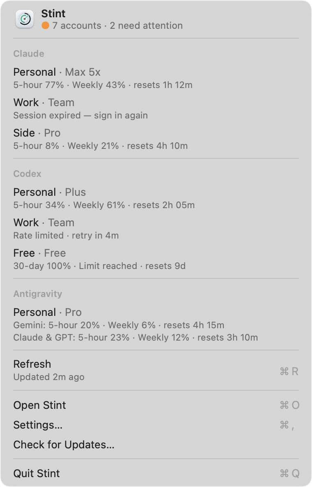
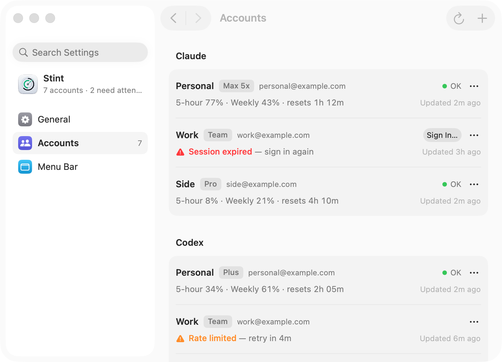

# Stint

Stint is a macOS menu bar app that tracks subscription usage limits across several Claude, Codex, and Antigravity accounts.

It keeps each login in the macOS Keychain, stores usage history in one local SQLite database, and shows it in a native Swift app built on a Rust core.

<picture>
  <source media="(prefers-color-scheme: dark)" srcset="assets/menu-dark.png">
  <source media="(prefers-color-scheme: light)" srcset="assets/menu-light.png">
  
</picture>

<picture>
  <source media="(prefers-color-scheme: dark)" srcset="assets/window-dark.png">
  <source media="(prefers-color-scheme: light)" srcset="assets/window-light.png">
  
</picture>

## Install

Requires macOS 15 or later (Apple silicon or Intel).

1. Download `Stint-<version>.dmg` from [GitHub Releases](https://github.com/tuanvumaihuynh/stint/releases/latest).
2. Open the disk image and drag **Stint** to **Applications**.

### Opening Stint the first time

Release builds are ad-hoc signed and are not notarized with an Apple Developer ID, so macOS Gatekeeper blocks the first launch. Either:

- Clear the quarantine attribute in Terminal:

  ```sh
  xattr -dr com.apple.quarantine /Applications/Stint.app
  ```

- Or try opening Stint once, then open **System Settings → Privacy & Security** and choose **Open Anyway**.

Later in-app updates downloaded through Sparkle are verified with EdDSA and install without repeating this step.

## Build from source

Requirements: macOS, Xcode, [rustup](https://rustup.rs) (the pinned toolchain installs on first build), and [just](https://github.com/casey/just).

Start the app:

```sh
just app
```

The Stint icon appears in the menu bar. Click it to open the menu, or choose **Open Stint** for the window, where you add, sign in again, rename, and remove accounts. Stint shows in the Dock only while the window is open. It refreshes every account when it starts and every five minutes.

How accounts sign in:

- **Claude and Codex:** Stint runs the provider's own sign-in (`claude auth login` or `codex login`) in a private directory, so your normal CLI login is untouched. The CLI must be installed.
- **Antigravity:** Stint opens Google's sign-in page in your browser and receives the answer on `localhost:51121`.

Stint then saves the login to your Keychain and renews it as it expires.

Debug builds can also add accounts from the terminal, and print an account's live quota:

```sh
just add-account claude Personal
just add-account antigravity Personal
just usage antigravity Personal
just remove-account claude Personal
```

To see the app with made-up accounts, pass a mock scenario: `default`, `refreshing`, `single`, `busy`, `offline`, `empty`, or `antigravity`.

```sh
just app default
```

Usage history is stored in `~/Library/Application Support/Stint/stint.db`. To try Stint against a throwaway database, set `STINT_DATA_DIR`:

```sh
STINT_DATA_DIR=/tmp/stint-try just app
```

## Development

List available tasks with `just --list`, and run formatting, clippy, and unit tests before opening a pull request:

```sh
just check
```

On macOS, `just app-test` runs the app's unit tests, and `just app-snapshot` photographs the menu and the window in every mock scenario, in light and dark mode, into `target/snapshots/`.

`just release 0.1.0` builds what ships: one universal app for Apple silicon and Intel Macs, ad-hoc signed, as `Stint-0.1.0.zip` and `Stint-0.1.0.dmg` in `target/dist/`. The build number is the branch's commit count. `just smoke-test 0.1.0` then launches the app from the disk image against a database from an older release and checks that it opens and migrates. Set `STINT_SMOKE_INTEL=1` to also run the Intel slice under Rosetta; macOS shows a notice about Intel apps afterwards.

Release builds update themselves with [Sparkle](https://sparkle-project.org). They read the appcast attached to the latest GitHub release, and install only archives signed with the EdDSA private key whose public half is in `macos/sparkle-public-key.txt`. Debug builds never update.

The macOS app lives in `macos/`, an Xcode project. Its Swift code calls the Rust core through `crates/stint-ffi`, whose static library and generated Swift bindings `just ffi` writes to `macos/Generated/`. Run `just ffi` once before building in Xcode.

The landing page at [stint.vumht.dev](https://stint.vumht.dev) is a static page in `web/`, served by a Cloudflare Worker. `just web` serves it locally, and pushes to `main` that change `web/` deploy it.

Workspace crates live under `crates/`:

- `crates/stint-core`: Domain types, SQLite WAL storage, and pace calculations.
- `crates/stint-providers`: Account sign-in (through the provider CLIs, or the browser for Antigravity), Keychain logins with renewal, and quota clients for Claude, Codex, and Antigravity.
- `crates/stint-ffi`: The core as the macOS app sees it, exported to Swift with UniFFI.
- `crates/stint-dev`: The `add-account`, `remove-account`, and `usage` development commands.

## License

Stint is licensed under the [Apache License 2.0](LICENSE).
